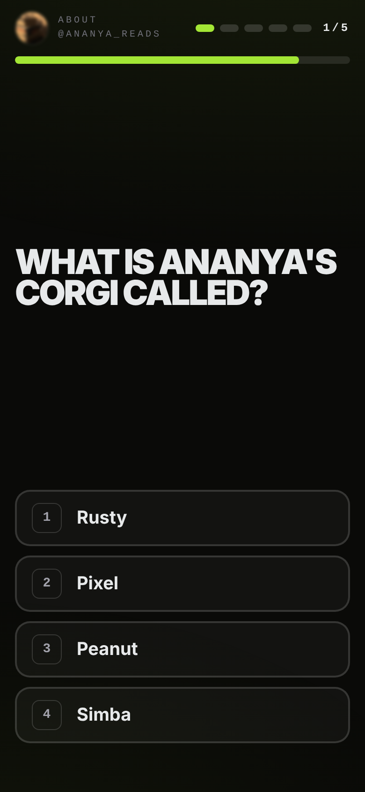

# 10-Second Sleuth

**Look at a profile for 10 seconds. Then see how much you remember.**

A short memory game for the Cipher club stall. A made-up social profile shows for 10 seconds, then
disappears. Five tap-to-answer questions follow (7 s each), then a score out of 5, a rank, and a short lesson
about how much ordinary posts reveal. Everyone in it is fictional.

Next.js 14 (App Router) + TypeScript + Tailwind 3.4. No backend, no accounts, no analytics, no runtime network
calls. The only thing stored is a per-device "best this session" and the profile shuffle bag in `localStorage`.


| Look | Quiz | Results |
|---|---|---|
|  |  |  |

## Run

```bash
npm install
npm run dev            # http://localhost:3000
# or the production build:
npm run build && npm start
```

Debug URL params (work on `/` and `/play`):

| Param | Effect |
|---|---|
| `?seed=123` | Reproducible runs (profile, questions, option order). The bag lives in memory only |
| `?time=15` | Look time in seconds (3–60, default 10) for easier sessions |
| `?kiosk=1` | Hides the nav pill and the Esc hint (results always auto-return to the title after 30 s idle) |

Keyboard: **Enter** = play / play again, **Esc** = back to title, **1–4** (or **A–D**) = answer.

## Test

```bash
npm run lint:content   # content rules (see below)
npm test               # vitest property tests, 2,000 seeds
npm run lint           # eslint
npm run build          # type check + production build
npm run e2e            # Playwright, needs a build first (see below)
```

`npm run e2e` (`scripts/e2e.mjs`) starts `next start` on port 3217 itself, plays the game in Chromium at
**1440×900** and **390×844**, and stops the server. Per viewport it does one full 10-second run (saving the
screenshots in `docs/`), then **20 consecutive runs** (with `?time=3` to keep it quick; reloading every 5 runs
to exercise the saved shuffle bag), then one run with the network **offline**. It fails if the profile screen
scrolls or is cut off, any of the 4 answers is off-screen or < 56 px, an image is broken, a right answer is not
on the profile (or a wrong one is), a profile repeats back-to-back, the page logs an error, or anything is
requested from outside the device. Playwright is not a project dependency: the script uses whatever
`require("playwright")` resolves (a global install is fine). `RUNS=5 npm run e2e` shortens it.

## Deploy (Vercel)

1. Push this repo to GitHub as `anmoln07/ten-second-sleuth`.
2. In Vercel: **Add New → Project**, import the repo. Framework preset **Next.js**, no env vars, defaults for
   everything else. Every push to `main` auto-deploys.
3. In Vercel → Project → **Settings → Domains**, add `sleuth.cipherbu.tech`.
4. At the DNS provider for `cipherbu.tech`, add:

   | Type | Name | Value |
   |---|---|---|
   | CNAME | `sleuth` | `cname.vercel-dns.com` |

5. At the stall, open the game at `https://sleuth.cipherbu.tech` (not `localhost`): the title-screen QR
   encodes the page's own address, so it must be the public one for phones to use it.

The site is fully static, so after the first load it keeps working if the Wi-Fi drops.

## Add a profile

Edit `content/profiles.ts` and add an object to the `profiles` array (copy an existing one):

- `id`, `name` (obviously invented), `handle`, `avatar` (a file in `public/pfp/`), `bio`, `location`,
  `joined` (`"Joined March 2023"`), `banner` (any CSS background, e.g. a gradient).
- 3–4 `posts` (`time` like `2h`, `text` ≤ 60 chars); **exactly one** has a `photo` (a file in `public/pfp/`).
- Exactly **6 `facts`**: 2 with `where: "bio"` (the bio or the location row), 3 `"post"`, 1 `"photo"`.
  Each `answer` must appear word-for-word (case-insensitive) in that area; the question must not contain the
  answer. `category` picks the wrong-answer pool: `pet city food drink hobby trip colour team gadget music`.

Then run `npm run lint:content && npm test`. The lint enforces all of the above plus: ≤ 80 visible words,
bio ≤ 70 chars, avatars exist, no duplicate ids/handles/answers, at least 5 safe wrong answers per fact, and
a banned-content scan (long numbers, emails, links, school/workplace words, birthdays, passwords/PINs,
addresses, ID documents).

**Content rules:** fictional people only, everyday topics only (pets, food, drinks, hobbies, colours, holiday
places, invented teams, music, gadgets). Never phone numbers, addresses, schools, workplaces, birth dates,
passwords or security answers, or anything about real people or brands. Only reuse the 18 images in
`public/pfp/`.

**Wrong answers** live in `content/distractors.ts` (≥ 8 per category, same style as the right answers). At run
time each question gets 3 drawn at random; any entry that matches the answer or shares a meaningful word with
anything on that profile is skipped automatically, so it's fine for a pool to contain other profiles' answers.
If the lint says a fact has too few safe distractors, add more entries to that pool.

## Tune the ranks and lines

- Rank thresholds and Dot's lines: **`content/ranks.ts`** (`min` = lowest score that earns the rank).
- Lesson lines (rotate per result): `content/lessons.ts`.
- Timings: `components/PlayClient.tsx` (`READY_MS`, `QUESTION_MS`, `FEEDBACK_MS`); look time default in
  `lib/params.ts`. Idle auto-return: `IDLE_MS` in `components/Results.tsx`.

## Layout

```
app/page.tsx, app/play/page.tsx   both render components/App.tsx (title <-> play switch in memory)
components/                       TitleScreen, DemoLoop, PlayClient (ready -> look -> quiz -> results),
                                  ProfileCard, Question, Timer, Ring, Results, QR, Magnetic, Dot, SiteNav
content/                          profiles, distractors, ranks, lessons, types
lib/                              rng (mulberry32), bag (shuffle bag), buildRun, text, params, storage, hooks
scripts/                          lint-content.ts, e2e.mjs
tests/                            run.property.test.ts
docs/                             screenshots from the e2e run
```
