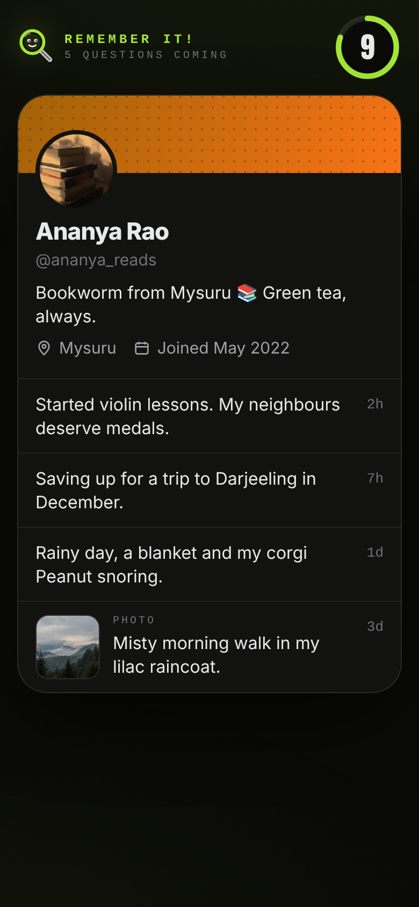
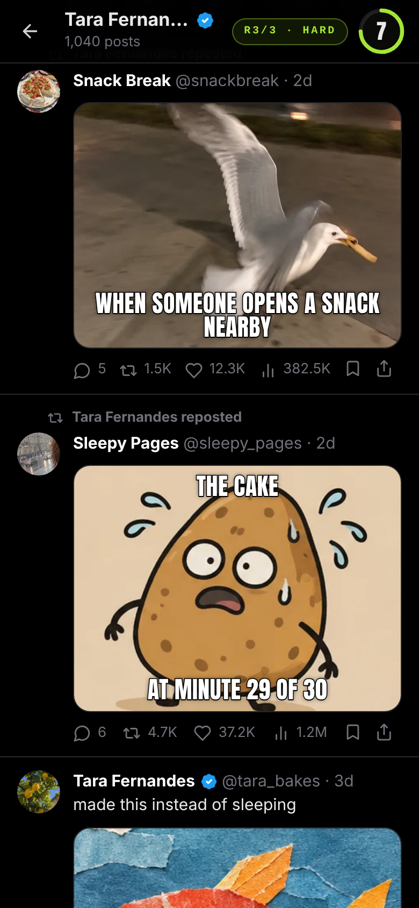
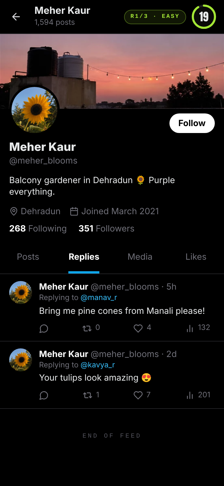
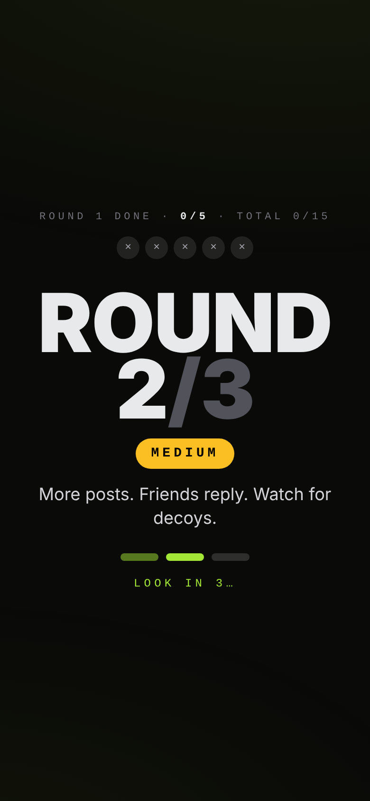
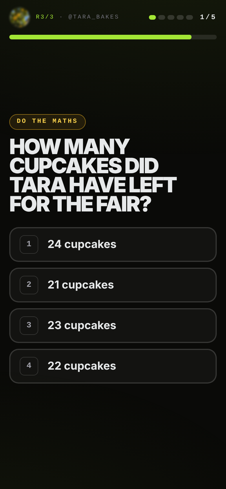
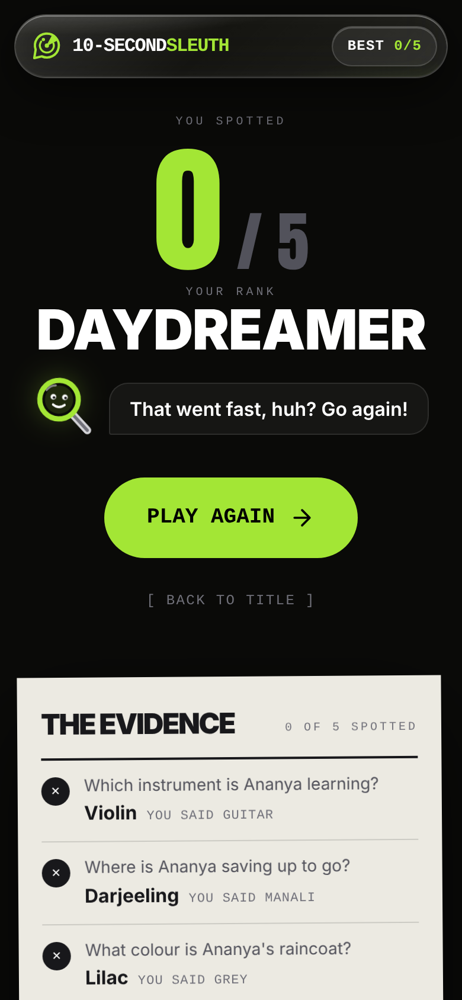
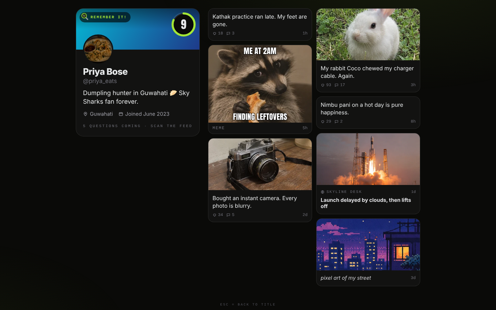

# Stalk 10

(Formerly "10-Second Sleuth". The GitHub repo and storage keys keep the old `ten-second-sleuth` / `sleuth` names; the Vercel project is `stalk-10`.)

**Look at a profile for 10 seconds. Then see how much you remember.**

A short memory game for the Cipher club stall. Three rounds, Easy → Medium → Hard. Each round a made-up
X-style profile shows for 10 seconds (scroll as fast as you like), then disappears. Five tap-to-answer
questions follow (7 s each). Watch out for **decoys** (a friend's dog when we ask about her cat) and
**look-alikes** (Biscotti vs Biscuit). The score is the number right out of 15, with a rank and the full
evidence list. Everyone in it is fictional.

Next.js 14 (App Router) + TypeScript + Tailwind 3.4. No backend, no accounts, no analytics, no runtime network
calls. The only things stored are a per-device "best this session" and the profile shuffle bags in `localStorage`.


| Look | Look (scrolled, Hard) | Replies tab | Round screen | Question | Results |
|---|---|---|---|---|---|
|  |  |  |  |  |  |

Laptop: 

## How a game runs

1. Title → **Play** (or Enter) → 3-2-1.
2. **Round 1 (Easy)**: 10 s look at an X profile (banner, avatar, bio, 📍/joined, followers, Posts/Replies/Media/Likes
   tabs, then the feed). **Posts**, **Replies** (their replies to friends) and **Media** (3-column grid of their
   photos/art) are clickable during the look without touching the timer; Likes is visual only. Every fact lives
   on the Posts tab. The feed order is shuffled every play; timestamps stay newest-first. The countdown ring
   sits in the sticky top bar (phones) or the sticky right panel (laptops), so it never scrolls away.
3. 5 questions, 7 s each. Wrong answers that were a decoy say **"Decoy!"**.
4. "Round 2 / 3 · Medium" screen (3.6 s, shows the round score), then the next look. Same for Hard.
5. Results: N / 15 on an LED scoreboard, rank, and the evidence (all 15 questions grouped by round, with what
   you picked). Results return to the title after 30 s idle.

## Run

```bash
npm install
npm run dev            # http://localhost:3000
# or the production build:
npm run build && npm start
```

Debug URL params (work on `/` and `/play`):

| Param | Effect |
|---|---|
| `?seed=123` | Reproducible games (profiles, feed order, questions, option order). The bags live in memory only |
| `?time=15` | Look time in seconds (3–60, default 10) for easier sessions |
| `?profile=mira` | Always use this profile for its difficulty's round (for authors) |
| `?kiosk=1` | Hides the nav pill and the Esc hint |

Keyboard: **Enter** = play / play again, **Esc** = back to title, **1–4** (or **A–D**) = answer.

## Test

```bash
npm run lint:content   # content rules (see below); add --stats for per-profile numbers
npx vitest run         # property tests (2,000 seeded games + every fact on every profile)
npm run lint           # eslint
npx tsc --noEmit       # type check
npm run build          # production build
npm run e2e            # Playwright full playthroughs (slow; needs a build first)
```

The property tests check, for every built question: 4 unique options, exactly one correct; recall answers
are on the profile; every wrong option is either a tagged decoy (on the profile, never the answer) or not on
the profile at all; photo answers are in that photo's `shows` tags; NOT questions' right answer is not on the
profile and the other three are; two-post inference answers equal the sum/difference of their clues; the
feed shuffle keeps every post and keeps times newest-first; and the per-difficulty shuffle bags never repeat
back-to-back.

`npm run e2e` (`scripts/e2e.mjs`) starts `next start` on port 3217, plays full games in Chromium at
**1440×900** and **390×844** (one with real 10 s looks that saves screenshots to `docs/`, then `RUNS` (5)
quick games with `?time=3`, then one offline), and stops the server. It fails on sideways scroll, a countdown
ring that scrolls away, broken images, text < 13 px, answers off-screen or < 56 px, invalid options, a missing
round screen, a wrong score, back-to-back repeats, console errors or any request leaving the device.
Playwright is not a project dependency: the script uses whatever `require("playwright")` resolves.

## Deploy (Vercel)

1. Push this repo to GitHub as `anmoln07/ten-second-sleuth`.
2. In Vercel: **Add New → Project**, import the repo. Framework preset **Next.js**, no env vars. Every push to
   `main` auto-deploys.
3. In Vercel → Project → **Settings → Domains**, add `sleuth.cipherbu.tech`, and at the DNS provider add a
   `CNAME sleuth → cname.vercel-dns.com`.
4. At the stall, open the game at `https://sleuth.cipherbu.tech` (not `localhost`): the title-screen QR
   encodes the page's own address.

The site is fully static and warms every image on the title screen, so after the first load it keeps
working if the Wi-Fi drops.

## Add a profile

Edit `content/profiles.ts` and add an object to the `profiles` array (copy one of the same difficulty).
Types are in `content/types.ts`; the per-difficulty rules are in `content/rules.ts`.

**Header:** `id`, `difficulty` (`"easy" | "medium" | "hard"`), `name` (obviously invented), `handle`,
`avatar` (a file in `public/pfp/`), `bio` (≤ 70 chars), `location` (an Indian city), `joined`
(`"Joined March 2023"`). Optional: `verified` (blue tick), `banner` (a place image from `public/feed/`),
`followers` / `following`, `species` (their own pet, if a pet photo is theirs).

**Feed** (`feed`, any order; it is shuffled every play):

- `text` – a plain post (`time`, `text`, `likes`).
- `photo` – an image from `public/feed/` plus a `caption`.
- `art` – their own art post; image + caption from `content/noise.ts`.
- `meme` / `news` – **reposts** from a meme page / outlet (noise). Text from `content/noise.ts`.
- Any own post can have `thread: [{ by: "kavya_r", text: "..." }]` – up to 2 friend replies. Friends live in
  `content/friends.ts`. Replies are where most decoys live.
- Give a post an `id` only if an inference fact points at it.
- `replies: [{ to: "kavya_r", time: "2h", text: "..." }]` – the Replies tab (≤ 4, ≤ 14 words each). Light
  chatter; decoys are fine here, but no fact may live only here (the lint checks every answer is on Posts).
  The Media tab is built from the feed's photo/art posts.
- ≤ 20 words per post, ≤ 14 per reply. Timestamps look like `2h` / `3d`.

**Facts** (`facts`) – each becomes a question. Kinds:

| Kind | Fields | Rule |
|---|---|---|
| recall (default) | `category`, `answer`, `where` (`bio` / `text` / `photo` caption / `reply`), optional `decoys`, `lookalikes` | the answer is written in that area |
| `kind: "photo"` | `image` (on this profile), `category`, `answer`, optional `decoys` | every word of the answer is in the image's `shows` tags in `public/feed/manifest.json`. Only ask what the picture **clearly** shows |
| `kind: "not"` | `categories`, `present` (≥ 3 things written on the profile) | "Which X was NOT on …'s profile?" Three of `present` + one thing that wasn't (Hard picks a look-alike of a present one: Pune → Puri) |
| `kind: "calc"` | `op` (`sum` / `diff`), `parts: [{ post, says, n }]`, `unit`, `answer` | two-post inference. `says` is copied from post `post` (or its replies) and contains `n`; `answer` = computed value + unit ("4 days"). Don't depend on timestamps |

- **Decoys**: things that are on the profile in another role ("Babysitting Arjun's dog Cookie" when the
  question is "What is Mira's cat called?"). List them on the fact; the lint checks each appears on the
  profile and never overlaps the answer. Up to 1 (Easy/Medium) or 2 (Hard) are offered per question.
- **Look-alikes**: near misses that are clearly wrong (Biscotti for Biscuit, Viola for Violin, Lavender for
  Lilac). Add them to `content/lookalikes.ts` (keyed by the lower-cased answer) or per fact. Never another
  name for the same thing (no Mysore for Mysuru). Medium and Hard offer one per question.
- The rest of the wrong answers come from `content/distractors.ts` (one pool per `category`), skipping
  anything on the profile or shown in its pictures.

**Difficulty shape** (`content/rules.ts`, enforced by the lint):

| | posts | noise | posts with replies | decoys | facts | photo/NOT/calc facts | words |
|---|---|---|---|---|---|---|---|
| Easy | 6–8 | ≥ 3 | ≥ 1 | ≥ 1 | 6–7 | any | ≤ 150 |
| Medium | 8–10 | ≥ 3 | ≥ 2 | ≥ 3 | 7–8 | ≥ 1 (asked every round) | ≤ 210 |
| Hard | 10–13 | ≥ 4 | ≥ 3 | ≥ 5 | 8–9 | ≥ 2 kinds (2 asked every round) | ≤ 280 |

Also enforced: ≥ 4 profiles per difficulty, a fact in the bio and one in a text post, images exist and are
used by ≤ 2 profiles, pet photos match `species` unless the post names the animal, no two facts share an
answer, ≥ 4 safe pool distractors per fact, and a banned-content scan (long numbers, emails, links,
school/workplace words, birthdays, passwords/PINs, addresses, ID documents, politics/religion).

Then run `npm run lint:content && npx vitest run`.

## Images

`public/feed/` holds the feed pictures; `manifest.json` gives each one a `kind` (`object food place pet meme
news art`), an aspect and `shows` tags (what the picture clearly shows; used for photo questions and to keep
wrong answers away from things in the pictures). `st-*` files (feed and `public/pfp/`) are copied from
SOCIALTRACE (the same author's assets). `news-02` shows faces in a crowd and is never used.

## Add noise captions

`content/noise.ts` holds the text for meme/news/art posts, keyed by image file name: `memeCaptions` (2–3 each,
`"top | bottom"` or bottom only), `newsHeadlines` (1–2 each, made-up outlet), `artCaptions` (1–2 each).
≤ 8 words, friendly, no real people, brands, outlets, politics or real news.

**Content rules:** fictional people only, everyday topics only (pets, food, drinks, hobbies, colours,
holiday places, invented teams, music, gadgets). Never phone numbers, addresses, schools, workplaces, birth
dates, passwords or security answers, or anything about real people or brands.

## Tune

- Rank thresholds (out of 15) and Dot's lines: `content/ranks.ts`.
- Difficulty shape and option mix (decoys / look-alikes per question): `content/rules.ts`.
- Lesson lines: `content/lessons.ts`.
- Timings: `components/PlayClient.tsx` (`READY_MS`, `BETWEEN_MS`, `QUESTION_MS`, `FEEDBACK_MS`); look time
  default in `lib/params.ts`. Idle auto-return: `IDLE_MS` in `components/Results.tsx`.

## Layout

```
app/page.tsx, app/play/page.tsx   both render components/App.tsx (title <-> play switch in memory)
components/                       TitleScreen, DemoLoop, PlayClient (ready -> look -> quiz -> between -> ... -> results),
                                  LookScreen, Question, Timer, Ring, Results, QR, Magnetic, Dot, SiteNav
components/x/                     XProfile, XPost, Verified, Icons (X look copied from SOCIALTRACE)
content/                          profiles, rules, friends, distractors, lookalikes, noise, ranks, lessons, types
lib/                              rng (mulberry32), bag (per-difficulty shuffle bags), buildRun, text, images,
                                  accounts, params, storage, hooks
scripts/                          lint-content.ts, e2e.mjs
tests/                            run.property.test.ts
docs/                             screenshots
```
